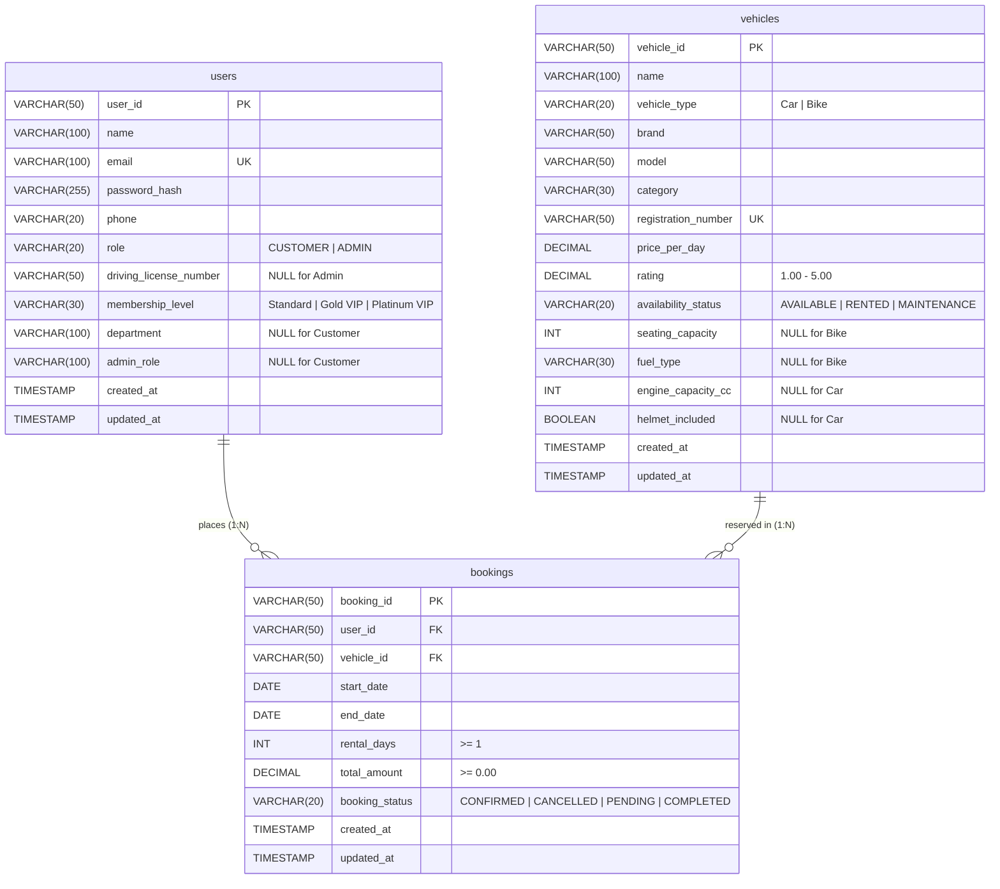

# RentIQ-Java
## Java-Based Enterprise Vehicle Rental Management System

Welcome to **RentIQ-Java**, an enterprise-grade vehicle rental management system built with **Core Java 26 (JDK 26.0.1)**, **Apache Maven**, **JDBC**, and **MySQL 8.0+**.

RentIQ-Java follows a clean layered architecture, demonstrating core object-oriented principles, the Java Collections Framework, Map/Queue data structures, sorting algorithms, multithreading fundamentals, advanced **Thread Coordination (wait, notify, notifyAll, guarded blocks, and the Producer-Consumer pattern)**, and **Relational Database Design with robust JDBC connectivity**.

---

## Table of Contents
1. [Prerequisites](#prerequisites)
2. [Project Architecture & Directory Structure](#project-architecture--directory-structure)
3. [Phase 3, Milestone 1: MySQL Database Design](#phase-3-milestone-1-mysql-database-design)
   - [3.1 Relational Schema Overview (`rentiq_db`)](#31-relational-schema-overview-rentiq_db)
   - [3.2 Entity-Relationship (ER) Diagram](#32-entity-relationship-er-diagram)
   - [3.3 Table Specifications & Integrity Constraints](#33-table-specifications--integrity-constraints)
   - [3.4 Booking Integrity & Date Conflict Architecture](#34-booking-integrity--date-conflict-architecture)
   - [3.5 Database Setup Instructions](#35-database-setup-instructions)
4. [Phase 3, Milestone 2: JDBC Connectivity Architecture](#phase-3-milestone-2-jdbc-connectivity-architecture)
   - [4.1 Architecture Overview](#41-architecture-overview)
   - [4.2 Database Configuration (`DatabaseConfig.java`)](#42-database-configuration-databaseconfigjava)
   - [4.3 Database Connection Utility (`DatabaseConnection.java`)](#43-database-connection-utility-databaseconnectionjava)
   - [4.4 Connection Testing & Diagnostic Harness (`DatabaseConnectionTest.java`)](#44-connection-testing--diagnostic-harness-databaseconnectiontestjava)
   - [4.5 Security & Environment Management](#45-security--environment-management)
   - [4.6 Graceful Degradation When MySQL is Offline](#46-graceful-degradation-when-mysql-is-offline)
5. [Phase 2, Milestone 4: Thread Coordination Deep Dive](#phase-2-milestone-4-thread-coordination-deep-dive)
6. [Educational Demonstrations Overview](#educational-demonstrations-overview)
7. [Console Application Menu Structure](#console-application-menu-structure)
8. [How to Compile, Test, and Run](#how-to-compile-test-and-run)
9. [Viva & Technical Interview Q&A](#viva--technical-interview-qa)

---

## Prerequisites

Before building or running the project, verify your environment:

1. **Java Development Kit (JDK):**
   - **Version:** Java 26 (JDK 26.0.1)
   - Verify:
     ```bash
     java -version
     javac -version
     ```
   - Ensure `JAVA_HOME` points to your JDK 26 installation (e.g. `C:\Program Files\Java\jdk-26.0.1`).

2. **Apache Maven / Maven Wrapper:**
   - **Version:** Maven 3.9+ (A pre-configured Maven Wrapper `mvnw` / `mvnw.cmd` is included in `backend-java/`).
   - Verify:
     ```bash
     mvn -version
     ```

3. **MySQL Database Server:**
   - **Version:** MySQL Server 8.0 or higher
   - Default Port: `3306`
   - Database Name: `rentiq_db`

---

## Project Architecture & Directory Structure

```
RentIQ-Java/
├── .env.example                                        # Environment configuration template
├── .gitignore                                          # Git ignore rules including .env and build output
├── README.md                                           # Comprehensive project documentation
├── backend-java/
│   ├── .env.example                                    # Backend environment template
│   ├── .mvn/wrapper/                                   # Maven Wrapper configuration
│   ├── mvnw                                            # Linux/macOS wrapper script
│   ├── mvnw.cmd                                        # Windows wrapper script
│   ├── pom.xml                                         # Maven POM (Java 26 + MySQL Connector/J)
│   └── src/
│       ├── main/
│       │   ├── java/com/rentiq/
│       │   │   ├── Main.java                           # Application entry point & automated runner
│       │   │   ├── config/                             # Configuration Layer
│       │   │   │   └── DatabaseConfig.java             # Safe DB config manager (env vars, .env, defaults)
│       │   │   ├── database/                           # Database & JDBC Layer
│       │   │   │   ├── DatabaseConnection.java         # JDBC connection manager via DriverManager
│       │   │   │   └── DatabaseConnectionTest.java     # Connection verification test harness & query runner
│       │   │   ├── concurrency/                        # Multithreading & Thread Coordination
│       │   │   │   ├── AtomicityVisibilityDemo.java    # Unsafe vs Sync vs AtomicInteger & Volatile
│       │   │   │   ├── BookingConsumer.java            # Consumer worker processing booking requests
│       │   │   │   ├── BookingNotificationTask.java    # Runnable async notification worker
│       │   │   │   ├── BookingProducer.java            # Producer worker submitting booking requests
│       │   │   │   ├── BookingRequestBuffer.java       # Thread-safe bounded buffer with wait/notifyAll
│       │   │   │   ├── FleetMonitorThread.java         # Background audit thread extending Thread
│       │   │   │   ├── GuardedBlockDemo.java           # Guarded block condition evaluation in while loops
│       │   │   │   ├── NotifyAllDemo.java              # Multiple waiting consumers & notifyAll demo
│       │   │   │   ├── ProducerConsumerDemo.java       # Complete Producer-Consumer integrated simulation
│       │   │   │   ├── RaceConditionDemo.java          # Double-booking race condition vs synchronized fix
│       │   │   │   ├── StartVsRunDemo.java             # start() new thread vs run() calling thread
│       │   │   │   ├── ThreadLifecycleDemo.java        # NEW, RUNNABLE, TIMED_WAITING, WAITING, TERMINATED
│       │   │   │   ├── ThreadPriorityDemo.java         # MIN_PRIORITY, NORM_PRIORITY, MAX_PRIORITY
│       │   │   │   └── WaitNotifyDemo.java             # wait() atomic lock release and notify() wakeup
│       │   │   ├── exception/                          # Custom checked domain exceptions
│       │   │   │   ├── InvalidBookingException.java
│       │   │   │   ├── InvalidUserException.java
│       │   │   │   └── VehicleNotAvailableException.java
│       │   │   ├── model/                              # Domain entities
│       │   │   │   ├── Admin.java
│       │   │   │   ├── Bike.java
│       │   │   │   ├── Booking.java
│       │   │   │   ├── BookingRequest.java
│       │   │   │   ├── Car.java
│       │   │   │   ├── Customer.java
│       │   │   │   ├── User.java
│       │   │   │   └── Vehicle.java
│       │   │   ├── service/                            # Layered business logic services
│       │   │   │   ├── BookingService.java             # Synchronized booking & queue processing
│       │   │   │   ├── UserService.java                # Customer/Admin registration & HashMaps
│       │   │   │   └── VehicleService.java             # Fleet inventory, Sets, sorting & search
│       │   │   ├── ui/console/
│       │   │   │   └── ConsoleApp.java                 # Interactive 16-option console menu
│       │   │   └── util/
│       │   │       ├── CollectionDemo.java             # Collections framework educational showcase
│       │   │       ├── DynamicArray.java               # Custom resizable array implementation
│       │   │       ├── GenericLinkedList.java          # Custom doubly-linked list implementation
│       │   │       └── VehicleComparators.java         # Multi-attribute vehicle comparators
│       │   └── resources/
│       │       └── db/
│       │           ├── sample-data.sql                 # Seed data (Users, Vehicles, Bookings)
│       │           └── schema.sql                      # Database DDL schema script
│       └── test/
│           ├── java/
│           └── resources/
└── database/
    ├── README.md                                       # Database documentation
    ├── sample-data.sql                                 # Seed data mirror
    └── schema.sql                                      # DDL schema mirror
```

---

## Phase 3, Milestone 1: MySQL Database Design

### 3.1 Relational Schema Overview (`rentiq_db`)
The database schema directly maps to the object-oriented Java domain models:
- **`users`**: Maps `User`, `Customer`, and `Admin` using a single-table inheritance strategy with discriminatory role attributes.
- **`vehicles`**: Maps `Vehicle`, `Car`, and `Bike` preserving specific technical metrics (fuel type, seating capacity, engine capacity, helmet inclusion).
- **`bookings`**: Maps `Booking` connecting a registered user to a reserved vehicle across specific calendar dates.

### 3.2 Entity-Relationship (ER) Diagram



### 3.3 Table Specifications & Integrity Constraints

1. **`users` Table:**
   - **Primary Key:** `user_id` (e.g. `U1001`, `U9001`).
   - **Unique Key:** `email` ensures no duplicate user accounts.
   - **Check Constraint:** `role IN ('CUSTOMER', 'ADMIN')`.
   - **Check Constraint:** `membership_level IN ('Standard', 'Gold VIP', 'Platinum VIP')`.
   - **Security:** Plaintext passwords are never stored; `password_hash` stores 64-character SHA-256 digests.

2. **`vehicles` Table:**
   - **Primary Key:** `vehicle_id` (e.g. `V101`, `B201`).
   - **Unique Key:** `registration_number` ensures physical vehicle uniqueness.
   - **Check Constraints:** `price_per_day >= 0.00`, `rating BETWEEN 0.00 AND 5.00`, `vehicle_type IN ('Car', 'Bike')`.
   - **Availability Check:** `availability_status IN ('AVAILABLE', 'RENTED', 'MAINTENANCE')`.

3. **`bookings` Table:**
   - **Primary Key:** `booking_id` (e.g. `BK-1001`).
   - **Foreign Keys:**
     - `fk_bookings_user`: References `users(user_id)` with `ON DELETE CASCADE ON UPDATE CASCADE`.
     - `fk_bookings_vehicle`: References `vehicles(vehicle_id)` with `ON DELETE RESTRICT ON UPDATE CASCADE` (preventing vehicle deletion if historical bookings exist).
   - **Date Range Constraint:** `end_date >= start_date`.
   - **Rental Days Constraint:** `rental_days >= 1`.
   - **Amount Constraint:** `total_amount >= 0.00`.
   - **Status Constraint:** `booking_status IN ('CONFIRMED', 'CANCELLED', 'PENDING', 'COMPLETED')`.

### 3.4 Booking Integrity & Date Conflict Architecture

RentIQ decouples overall vehicle fleet status from specific calendar reservations:
- A vehicle can have multiple non-overlapping bookings over time (e.g. booked Dec 1–4, and booked Dec 20–24).
- A composite index `idx_bookings_date_range (vehicle_id, start_date, end_date, booking_status)` enables fast overlap detection:
  ```sql
  -- Checking for booking conflicts on a vehicle:
  SELECT COUNT(*) FROM bookings
  WHERE vehicle_id = ?
    AND booking_status = 'CONFIRMED'
    AND start_date <= ? AND end_date >= ?;
  ```
- When a booking is marked `CANCELLED` or `COMPLETED`, that calendar window becomes immediately available again for future reservations without requiring manual vehicle flag resets.

### 3.5 Database Setup Instructions

To initialize the database locally:

```bash
# 1. Open MySQL CLI
mysql -u root -p

# 2. Source the schema script
source backend-java/src/main/resources/db/schema.sql;

# 3. Source the sample data seed script
source backend-java/src/main/resources/db/sample-data.sql;

# 4. Verify tables
USE rentiq_db;
SHOW TABLES;
SELECT 'users' AS tbl, COUNT(*) AS count FROM users
UNION ALL SELECT 'vehicles', COUNT(*) FROM vehicles
UNION ALL SELECT 'bookings', COUNT(*) FROM bookings;
```

---

## Phase 3, Milestone 2: JDBC Connectivity Architecture

### 4.1 Architecture Overview

RentIQ implements standard JDBC without heavy ORM frameworks (No Spring Boot, No Hibernate, No JPA):

```
┌────────────────────────────────────────────────────────┐
│             RentIQ Application (Main / Console)        │
└──────────────────────────┬─────────────────────────────┘
                           │
                           ▼
┌────────────────────────────────────────────────────────┐
│             DatabaseConnectionTest.java                │
│    (Ping Query, Metadata Inspection, Diagnostics)      │
└──────────────────────────┬─────────────────────────────┘
                           │
                           ▼
┌────────────────────────────────────────────────────────┐
│               DatabaseConnection.java                  │
│       (getConnection, isValid, Error Translation)      │
└──────────────┬─────────────────────────┬───────────────┘
               │                         │
               ▼                         ▼
┌────────────────────────────┐ ┌─────────────────────────┐
│    DatabaseConfig.java     │ │   MySQL Connector/J     │
│  (Env Vars, .env, Defaults)│ │ (com.mysql.cj.jdbc.     │
│                            │ │        Driver)          │
└────────────────────────────┘ └───────────┬─────────────┘
                                           │
                                           ▼
                               ┌─────────────────────────┐
                               │   MySQL Server (3306)   │
                               │      (rentiq_db)        │
                               └─────────────────────────┘
```

### 4.2 Database Configuration (`DatabaseConfig.java`)
- **Credential Hierarchy:**
  1. Primary Environment Variables (`RENTIQ_DB_URL`, `RENTIQ_DB_USERNAME`, `RENTIQ_DB_PASSWORD`)
  2. Standard Fallback Variables (`DB_URL`, `DB_USER`, `DB_PASSWORD`)
  3. Local `.env` file (parsed using Core Java standard library)
  4. Safe local default (`jdbc:mysql://localhost:3306/rentiq_db`, user `root`, empty password)
- **Security:** `getMaskedPassword()` masks sensitive information (e.g. `********`), ensuring credentials are never exposed in logs or user-facing output.

### 4.3 Database Connection Utility (`DatabaseConnection.java`)
- **Driver Loading:** Explicitly registers `com.mysql.cj.jdbc.Driver`.
- **Factory Method:** `getConnection()` returns a new `java.sql.Connection` managed via `DriverManager`.
- **Health Validation:** `isConnectionValid(Connection, timeoutSeconds)` verifies connection responsiveness.
- **Diagnostic Method:** `testConnection()` executes a non-intrusive probe and returns structured diagnostic information (`serverVersion`, `databaseName`, `responseTimeMs`).

### 4.4 Connection Testing & Diagnostic Harness (`DatabaseConnectionTest.java`)
- Executes test workflow:
  1. Config loading & sanitized display
  2. Connection establishment
  3. Metadata inspection (DBMS product, driver version, active database catalog)
  4. SELECT ping query (`SELECT 1 AS ping, CURRENT_TIMESTAMP, DATABASE()`)
  5. Table record count query (`users`, `vehicles`, `bookings`)
  6. Resource closure via try-with-resources
- Exposes `executeVerificationQuery(String sql)` with strict read-only security guards (allowing only `SELECT` and `SHOW`).

### 4.5 Security & Environment Management
- Real passwords are never committed to version control.
- Both root `.gitignore` and `backend-java/.gitignore` ignore `.env` files.
- `.env.example` is provided in the repository with placeholder configurations:
  ```env
  RENTIQ_DB_URL=jdbc:mysql://localhost:3306/rentiq_db?useSSL=false&allowPublicKeyRetrieval=true&serverTimezone=UTC
  RENTIQ_DB_USERNAME=root
  RENTIQ_DB_PASSWORD=your_secure_password_here
  ```

### 4.6 Graceful Degradation When MySQL is Offline
If MySQL is not installed or unreachable:
- `DatabaseConnection.testConnection()` and `DatabaseConnectionTest.runConnectionTest()` catch `SQLException`, output friendly diagnostic guidance, and return `false`.
- The application and all in-memory domain demonstrations (Collections, Maps, Multithreading, Thread Coordination, and Console operations) continue running with zero crashes.

---

## Phase 2, Milestone 4: Thread Coordination Deep Dive

### The Need for Thread Coordination
In concurrent systems, `synchronized` guarantees mutual exclusion, but threads must also communicate when state conditions change. Polling in spin loops wastes CPU cycles. Java's `wait()`, `notify()`, and `notifyAll()` allow worker threads to release locks and wait efficiently until signaled.

### Guarded Blocks & Condition Testing in `while` Loops
Guard conditions must **always** be tested inside a `while` loop, never an `if` statement:
```java
synchronized (lock) {
    while (buffer.isEmpty() && !shutdown) {
        lock.wait(); // Atomically releases monitor lock
    }
    // Condition verified true before consuming
}
```
- **Spurious Wakeups:** The OS/JVM may wake a thread without an explicit notification; the `while` loop rechecks the condition.
- **Stolen Signals:** When `notifyAll()` wakes multiple consumers, the first consumer to acquire the lock claims the item. Subsequent awakened threads re-evaluate the loop and safely return to waiting.

---

## Educational Demonstrations Overview

| Demo Class | Core Concept Demonstrated |
| :--- | :--- |
| `DatabaseConnectionTest.java` | JDBC connection lifecycle, metadata inspection, verification queries, and diagnostic error handling. |
| `WaitNotifyDemo.java` | Single consumer waiting on empty buffer, atomic lock release, state inspection (`WAITING`), producer submission, and `notify()` wakeup. |
| `NotifyAllDemo.java` | 3 concurrent consumers waiting on empty buffer, 2 items produced, `notifyAll()` broadcast wakeup, condition recheck in while loop, and zero duplicate processing. |
| `GuardedBlockDemo.java` | Guard condition evaluation in a `while` loop, simulation of condition changes, and why `while` prevents spurious wakeups. |
| `ProducerConsumerDemo.java` | End-to-end multi-threaded workflow: 5 requests, 2 consumer threads, 1 producer thread, bounded buffer (capacity 3), and clean shutdown. |

---

## Console Application Menu Structure

The interactive console menu (`ConsoleApp.java`) provides 16 options:

```
----------------- RentIQ Main Menu -----------------
1.  Register User
2.  View Users
3.  View Vehicles
4.  Search Vehicles
5.  Book Vehicle
6.  View Bookings
7.  Cancel Booking
8.  View Recently Viewed Vehicles (LinkedList)
9.  View Unique Vehicle Categories (HashSet & LinkedHashSet)
10. View Sorted Vehicle Categories (TreeSet)
11. Run Complete Collections Framework Demonstration
12. Maps, Queues, Iterators & Sorting Submenu (Milestone 2)
13. Multithreading Demonstrations Submenu (Milestone 3)
14. Thread Coordination Demonstrations Submenu (Milestone 4)
15. Database Connectivity Submenu (Phase 3 - Milestones 1 & 2)
16. Exit
----------------------------------------------------
```

### Option 15: Database Connectivity Submenu

```
======= Database Connectivity Submenu (Phase 3 - Milestones 1 & 2) =======
1. Test MySQL Connection (Ping & Diagnostics)
2. Display Database Connection Status & Configuration
3. Execute Simple Database Verification Query
4. Return to Main Menu
==========================================================================
```

---

## How to Compile, Test, and Run

Navigate to the `backend-java/` directory:

```bash
cd backend-java
```

### 1. Compile the Project
Using Maven Wrapper (Windows):
```cmd
.\mvnw.cmd clean compile
```
Using standard Maven:
```bash
mvn clean compile
```

### 2. Run Automated Tests
```cmd
.\mvnw.cmd test
```

### 3. Execute the Application
```cmd
.\mvnw.cmd exec:java
```

The application automatically executes:
- Core Java String handling, wrappers, and exception handling demonstrations.
- Collections framework showcase (ArrayList, LinkedList, HashSet, LinkedHashSet, TreeSet).
- Maps, Queues, Iterators, and Sorting demonstrations.
- Multithreading Fundamentals (Thread, Runnable, start vs run, sleep, join, interrupt, lifecycle states, daemon threads, priorities, race conditions, atomic & volatile).
- Thread Coordination Live Demonstrations (wait, notify, notifyAll, guarded blocks, bounded buffer producer-consumer, graceful shutdown).
- **MySQL JDBC Connectivity Live Verification** (configuration inspection, live connection test, database metadata, and table record counts).
- Automated interactive console session exercising all menus and submenus.

---

## Viva & Technical Interview Q&A

**Q1: Why use JDBC directly instead of an ORM like Hibernate or Spring Data JPA?**
> Core JDBC provides direct, low-level control over SQL queries, transactions, connection lifecycles, and performance without the overhead, magic, or caching abstractions of heavy ORMs. Understanding JDBC fundamentals is essential for writing efficient database code.

**Q2: What is the purpose of `Class.forName("com.mysql.cj.jdbc.Driver")`?**
> In older JDBC specifications (pre-JDBC 4.0), it explicitly loaded and registered the driver class with `DriverManager`. While JDBC 4.0+ supports automatic Service Provider Interface (SPI) discovery via `META-INF/services/java.sql.Driver`, explicit registration remains a recommended safeguard across custom classloaders and shaded environments.

**Q3: Why is try-with-resources critical when working with JDBC `Connection`, `Statement`, and `ResultSet`?**
> All JDBC resources (`Connection`, `Statement`, `PreparedStatement`, `ResultSet`) encapsulate underlying physical database socket handles and server cursors. Failing to close them leads to cursor exhaustion, socket leaks, and connection pool starvation. Try-with-resources guarantees automatic deterministic closure even if an exception occurs.

**Q4: How does RentIQ prevent SQL injection vulnerabilities?**
> Although Milestones 1 & 2 only establish connection testing, query execution harnesses restrict input to read-only statements, and subsequent milestones will employ parameterized `PreparedStatement` with bind variables (`?`), ensuring user inputs are treated as literal data rather than executable SQL.

**Q5: How does RentIQ handle date-based booking conflicts without permanently locking vehicles?**
> Instead of relying solely on an in-place `available` boolean, RentIQ's relational schema checks for overlapping date ranges on confirmed bookings (`WHERE vehicle_id = ? AND booking_status = 'CONFIRMED' AND start_date <= ? AND end_date >= ?`). When a booking concludes or is cancelled, that date window automatically becomes free for other reservations.

---

## License

This project is part of the RentIQ vehicle rental management platform. All rights reserved.
