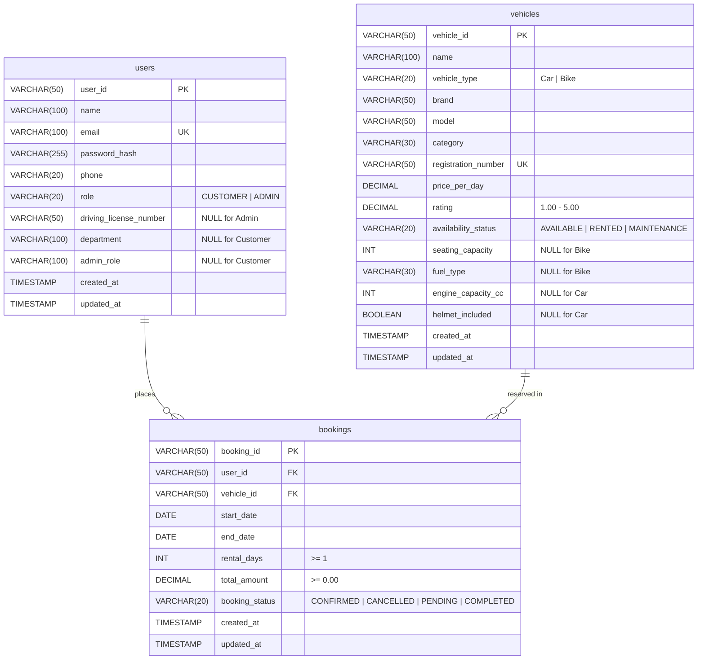

# RentIQ Database Scripts & Documentation
## Database: `rentiq_db`

This directory provides the relational database definitions and seed data for the **RentIQ Vehicle Rental Management System**.

---

## Files

1. **`schema.sql`**: Full DDL schema script creating database `rentiq_db`, tables (`users`, `vehicles`, `bookings`), primary keys, foreign keys with cascade rules, check constraints, and performance indexes.
2. **`sample-data.sql`**: Realistic initial seed data inserting 1 Administrator, 4 Customers, 7 Cars, 5 Bikes, and 5 historical/active Bookings matching the in-memory Java domain models.

---

## Entity-Relationship (ER) Overview



---

## Setup & Execution

### 1. Execute Schema Creation
```bash
mysql -u root -p < schema.sql
```

### 2. Populate Sample Data
```bash
mysql -u root -p < sample-data.sql
```

### 3. Verify in MySQL Client
```sql
USE rentiq_db;
SHOW TABLES;
SELECT 'users' AS tbl, COUNT(*) AS count FROM users
UNION ALL SELECT 'vehicles', COUNT(*) FROM vehicles
UNION ALL SELECT 'bookings', COUNT(*) FROM bookings;
```
